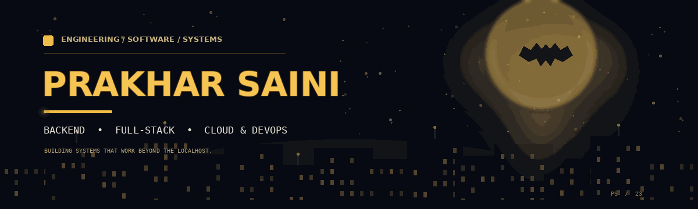
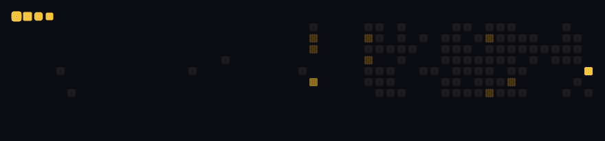

<!--
  Profile README for: github.com/sainiprakhar23
  Visual direction: Batman-inspired noir — midnight black, signal gold, animated city + bat signal.
  Keep this README in the root of the repository named exactly: sainiprakhar23.
-->

  

  

  
  
  

  

🦇 Profile Brief
I'm a fourth-year B.Tech Computer Science student focused on backend engineering, full-stack development, and cloud/DevOps. I enjoy building the complete path from an API and its data model to containers, deployment pipelines, and monitoring.
- 🔧 Build: REST APIs, authentication, database-backed services, and full-stack applications.
- ☁️ Deploy: Docker, AWS, Terraform, Jenkins, and Kubernetes-based workflows.
- 📡 Observe: Prometheus, Grafana, metrics, and service health.
- 🧠 Practise: C++ data structures and algorithms, system design, and problem solving.

<b>DESIGN → BUILD → DEPLOY → OBSERVE → IMPROVE</b>

  

⚙️ Current Focus
Track	What I'm working on
Backend Engineering	Node.js, Express, REST APIs, authentication, PostgreSQL, Redis
Full-Stack Development	React, TypeScript, JavaScript, Tailwind CSS
Cloud & DevOps	Docker, AWS, Terraform, Jenkins, Kubernetes, CI/CD
Observability	Prometheus, Grafana, metrics, health checks, logging
Problem Solving	C++, DSA patterns, LeetCode practice

🧩 Selected Builds
<table>
  <tr>
    <td width="50%" valign="top">
      <h3><a href="https://github.com/sainiprakhar23/url-shortner-devops">01 / URL Shortener — DevOps</a></h3>
      
A URL-shortening backend using Node.js, Express, PostgreSQL, Drizzle ORM, and JWT authentication. The engineering work extends into Docker Compose, Jenkins CI/CD, Terraform/AWS infrastructure, and Prometheus/Grafana monitoring.

      

        
        
        
        
        
      

    </td>
    <td width="50%" valign="top">
      <h3><a href="https://github.com/sainiprakhar23/SharedSketch">02 / SharedSketch</a></h3>
      
A real-time collaborative drawing application using Socket.IO. Its deployment stack explores Redis, Docker, Kubernetes, Terraform, AWS, and application monitoring.

      

        
        
        
        
        
      

    </td>
  </tr>
  <tr>
    <td width="50%" valign="top">
      <h3><a href="https://github.com/sainiprakhar23/Aegis-API">03 / Aegis-API</a></h3>
      
A backend/microservices project exploring API gateway patterns, JWT authentication, rate limiting, circuit breakers, Redis/PostgreSQL, and observability integrations.

      

        
        
        
        
      

    </td>
    <td width="50%" valign="top">
      <h3><a href="https://github.com/sainiprakhar23/Leetcode-Solutions">04 / DSA Practice</a></h3>
      
My C++ problem-solving practice across arrays, strings, binary search, sliding windows, stacks, recursion, and dynamic programming.

      

        
        
        
      

      
<a href="https://github.com/sainiprakhar23/GFG-Solutions">GeeksforGeeks solutions →</a>

    </td>
  </tr>
</table>

  

🛠️ Technology Arsenal

<b>LANGUAGES</b>

  

<b>FRONTEND</b>

  

<b>BACKEND & DATA</b>

  

<b>CLOUD, DEVOPS & TOOLS</b>

  

📡 GitHub Telemetry

  
  

  

  

🐍 Contribution Signal

  

  

<i>“The work speaks. The commits leave a trail.”</i>

  

